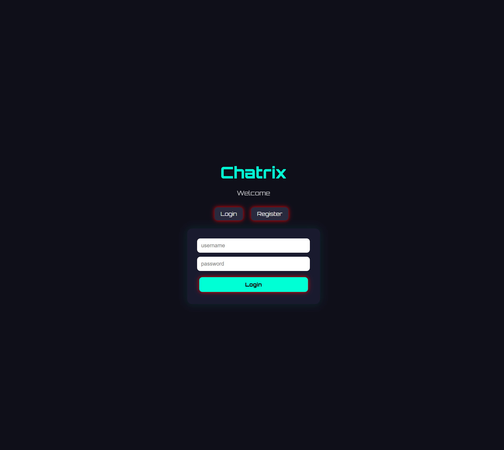

# 💬 Chatrix – Fullstack Real-Time Chat Application



## 📸 Screenshots


Chatrix is a fullstack real-time chat application built with JavaScript, Node.js, Express and MongoDB.

The application features user authentication, real-time public messaging, private one-to-one chat rooms and image sharing. It is an ongoing project focused on learning and building practical fullstack development skills.

## 🚀 Features

- 🔐 User registration and login
- 🔑 JWT-based authentication
- 🔒 Protected chat access
- 💬 Real-time public chat using Socket.IO
- 🧑‍🤝‍🧑 Private one-to-one chat rooms
- 🎯 Partner matching based on gender preferences
- 🖼️ Image sharing in public and private chats
- ⏭️ Next and Leave controls for private rooms
- 🔐 Password hashing with bcrypt
- 📱 Responsive user interface
- ⚡ Instant message updates without page refresh

## 🧱 Tech Stack

### Frontend
- HTML5
- CSS3
- Vanilla JavaScript
- Socket.IO Client
- Lucide Icons

### Backend
- Node.js
- Express.js
- Socket.IO
- MongoDB
- Mongoose
- JSON Web Tokens (JWT)
- bcrypt

## 📁 Project Structure

```text
Chatrix/
├── chatrix-client/
│   ├── index.html
│   ├── login.html
│   ├── index.js
│   └── style.css
│
├── chatrix-server/
│   ├── models/
│   │   └── User.js
│   ├── routes/
│   │   └── auth.routes.js
│   ├── server.js
│   ├── package.json
│   └── package-lock.json
│
├── .gitignore
├── README.md
└── screenshot.png
```

## ⚙️ Getting Started

### 1. Clone the repository

```bash
git clone https://github.com/ivanosna/Chatrix.git
cd Chatrix
```

### 2. Install backend dependencies

```bash
cd chatrix-server
npm install
```

### 3. Configure environment variables

Create a `.env` file inside the `chatrix-server` directory:

```env
MONGODB_URI=your_mongodb_connection_string
JWT_SECRET=your_secret_key
```

Replace the example values with your own MongoDB connection string and a secure JWT secret.

### 4. Start the server

```bash
node server.js
```

### 5. Open the application

Navigate to:

http://localhost:2000/login.html

## 🔐 Authentication Flow

1. Users can register and log in.
2. Passwords are hashed using bcrypt.
3. The server generates a JWT after successful login.
4. The token is stored in localStorage.
5. Socket.IO connections are authenticated using the JWT.
6. Chat access is restricted to authenticated users.

## 🛠️ Current Development

Chatrix is actively being developed. Planned improvements include:

- ❤️ Mutual likes and match notifications
- 💾 Saving matched private conversations
- 📜 Private chat history
- 👤 User profiles
- 🟢 Online status
- ☁️ Deployment

## 👨‍💻 Author

**Ivan**

Aspiring Fullstack Developer – currently focusing on Backend Development.

## 📌 Project Status

Chatrix is a personal learning project that I continuously improve by implementing new features and working with real backend technologies.

The goal is to build a deeper understanding of fullstack development, authentication, databases and real-time communication.